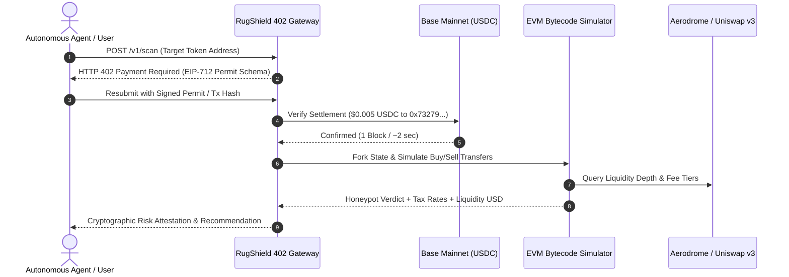

# RugShield 402 🛡️

[](https://basescan.org)
[](https://mcpize.com)
[](https://rugshield-402.onrender.com/.well-known/x402.json)
[](https://www.npmjs.com/package/@kurox_real/plugin-rugshield-402)
[](https://www.npmjs.com/package/@kurox_real/agentkit-rugshield-402)
[](https://t.me/RugShield402_bot)
[](https://ak10082247-max.github.io/rugshield-402/)
[](https://github.com/ak10082247-max/rugshield-402/releases)
[](https://opensource.org/licenses/MIT)

> **Autonomous DEX Honeypot Detection & Pre-Swap Simulation Engine for AI Agents on Base.**  
> Gated natively by the **HTTP 402 Payment Required** micro-payment standard ($0.005 USDC per scan on Base Mainnet) and recurring monthly fiat subscriptions on MCPize.

---

## 💳 Subscribe on MCPize / Apify ($19/mo Pro)

For crypto trading firms, quantitative bots, and AI agents that prefer fiat credit card billing via Stripe Connect over per-scan crypto micro-transactions:

| Plan | Price | Monthly Quota | Key Features |
|---|---|---|---|
| **Starter** | **$9.99 / mo** | 2,000 scans | Base bytecode simulation, buy/sell tax rate check, liquidity lock |
| **Pro (Recommended)** | **$19.99 / mo** | 20,000 scans | Real-time DEX pre-swap simulation, blacklist check, sub-100ms RPC cache |
| **Enterprise** | **$49.99 / mo** | 75,000 scans | Mempool frontrun alerts, dedicated private node, direct developer support |

- **Instant 1-Click Subscribe**: Paste `https://github.com/ak10082247-max/rugshield-402` into your **[MCPize Dashboard](https://mcpize.com/dashboard)**.
- **Direct Remote MCP Endpoint**: `https://rugshield-402.onrender.com/mcp`

---

## ⚡ Live Deployments & Distribution Channels

| Channel | Target User | Link / Install | Status |
|---|---|---|---|
| 🌐 **Web Scanner DApp** | Retail traders & degens | [ak10082247-max.github.io/rugshield-402](https://ak10082247-max.github.io/rugshield-402/) | **Live** |
| 🤖 **Telegram Scanner Bot** | Groups, channels, alpha callers | [@RugShield402_bot](https://t.me/RugShield402_bot) | **Live** |
| 📦 **ElizaOS Agent Plugin** | ElizaOS autonomous trading bots | `npm i @kurox_real/plugin-rugshield-402` | **Live on npm** |
| ⚡ **Coinbase AgentKit** | Base AgentKit & LangChain bots | `npm i @kurox_real/agentkit-rugshield-402` | **Live on npm** |
| 🛠️ **Model Context Protocol**| Claude Desktop, Cursor, Windsurf | [server-card.json](https://rugshield-402.onrender.com/.well-known/mcp/server-card.json) | **Live on Render** |
| 📡 **Cloud Microservice** | REST API & custom scripts | `https://rugshield-402.onrender.com/v1/scan` | **Live 24/7** |

---

## 🏛️ System Architecture



---

## 📦 Quickstart: Developer Integrations

### 1. ElizaOS Autonomous Agent Plugin

Install from the global npm registry:

```bash
npm install @kurox_real/plugin-rugshield-402
```

Register in your agent character definition:

```typescript
import { rugshieldPlugin } from "@kurox_real/plugin-rugshield-402";

export const character = {
  name: "AutonomousDeFiTrader",
  plugins: [rugshieldPlugin],
  // ... rest of character config
};
```

When your agent evaluates a swap, it triggers the `PRE_SWAP_RISK_CHECK` action automatically.

---

### 2. Coinbase AgentKit (LangChain / Python / TS)

Install the provider:

```bash
npm install @kurox_real/agentkit-rugshield-402
```

Initialize with AgentKit:

```typescript
import { rugshieldActionProvider } from "@kurox_real/agentkit-rugshield-402";
import { AgentKit } from "@coinbase/agentkit";

const agentKit = await AgentKit.from({
  actionProviders: [rugshieldActionProvider()],
});
```

---

### 3. Direct HTTP API (cURL / Any Language)

```bash
curl -X POST https://rugshield-402.onrender.com/v1/scan \
  -H "Content-Type: application/json" \
  -d '{
    "token_address": "0x4200000000000000000000000000000000000006",
    "chain_id": 8453,
    "simulate_sell": true
  }'
```

---

### 4. Python / Quantitative Bot Wrapper

```python
import requests

def scan_token(token_address: str):
    url = "https://rugshield-402.onrender.com/v1/scan"
    res = requests.post(url, json={
        "token_address": token_address,
        "chain_id": 8453,
        "simulate_sell": True
    })
    
    if res.status_code == 402:
        payment_info = res.json()
        print("x402 Payment Challenge:", payment_info)
        # Agent signs and includes payment permit
    return res.json()
```

---

## 🔒 Verified On-Chain Settlement

- **Settlement Chain**: Base Mainnet (`eip155:8453`)
- **Asset**: Native USDC (`0x833589fCD6eDb6E08f4c7C32D4f71b54bdA02913`)
- **Cost**: $0.005 USDC per verification
- **Merchant Address**: [`0x73279fa4BadA7CAC888c62CDa4f5c8104765f6f1`](https://basescan.org/address/0x73279fa4BadA7CAC888c62CDa4f5c8104765f6f1)
- **Sample Mainnet Settlement Tx**: [`0x80ab5a51f968bd845229d3abc98d5cedb28ba02647eac29004c20c663bd9f4a0`](https://basescan.org/tx/0x80ab5a51f968bd845229d3abc98d5cedb28ba02647eac29004c20c663bd9f4a0)

---

## 📄 License

MIT © 2026 RugShield 402 Contributors.
