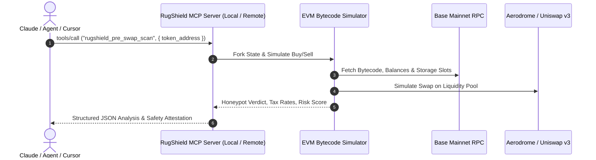

# RugShield 402 🛡️ — Open-Source MCP Server for DEX Security & Honeypot Detection

[](LICENSE)
[](https://modelcontextprotocol.io)
[](https://www.typescriptlang.org)
[](https://basescan.org)
[](https://rugshield-402.onrender.com/.well-known/x402.json)
[](https://glama.ai/mcp/servers/ak10082247-max/rugshield-402)

This repository contains the complete **open-source Model Context Protocol (MCP) server implementation** of **RugShield 402**. It equips LLMs, autonomous trading agents, and IDEs (Claude Desktop, Cursor, Windsurf) with tools to simulate token buys/sells, analyze honeypot traps, calculate exact transfer tax rates, and verify DEX liquidity depth on Base and EVM networks.

---

## 🛠️ MCP Tools Implemented

This MCP server provides the following tools via standard `stdio` and streamable `HTTP` transports:

| Tool Name | Description | Key Parameters |
|---|---|---|
| **`rugshield_pre_swap_scan`** | Comprehensive pre-trade swap simulation: detects honeypots, malicious transfer limits, and liquidity drain traps. | `token_address` (string, 42-char hex), `simulate_sell` (boolean, default: `true`) |
| **`check_honeypot`** | Decompiles token bytecode and executes buy/sell test against Base RPC. Returns exact buy/sell tax in basis points (`bps`), blacklist checks, and risk score. | `token_address` (string, 42-char hex) |
| **`verify_liquidity_lock`** | Analyzes DEX pool reserves (Uniswap v3, Aerodrome), LP token lock status, bonding curve state, and total USD liquidity depth. | `token_address` (string, 42-char hex) |
| **`detect_holder_clusters`** | Maps top token holder distributions, detects Sybil wallet clusters, and computes developer concentration risk. | `token_address` (string, 42-char hex) |

---

## 🚀 Running from Source (Local Stdio Transport)

You can run this MCP server locally on your machine from source code using Node.js and the Model Context Protocol SDK.

### 1. Installation & Build

```bash
# Clone the open-source repository
git clone https://github.com/ak10082247-max/rugshield-402.git
cd rugshield-402

# Install dependencies
npm install

# Build the TypeScript source code
npm run build
```

### 2. Configure with Claude Desktop

Add this server to your `claude_desktop_config.json`:

* **macOS**: `~/Library/Application Support/Claude/claude_desktop_config.json`
* **Windows**: `%APPDATA%\Claude\claude_desktop_config.json`

```json
{
  "mcpServers": {
    "rugshield-402": {
      "command": "node",
      "args": [
        "/absolute/path/to/rugshield-402/dist/mcp/server.js"
      ]
    }
  }
}
```

Or run directly with `tsx` during development without building:

```json
{
  "mcpServers": {
    "rugshield-402": {
      "command": "npx",
      "args": [
        "-y",
        "tsx",
        "/absolute/path/to/rugshield-402/src/mcp/server.ts"
      ]
    }
  }
}
```

### 3. Configure with Cursor or Windsurf

Add to your workspace `.cursor/mcp.json` or Windsurf MCP settings:

```json
{
  "mcpServers": {
    "rugshield-402": {
      "command": "node",
      "args": ["dist/mcp/server.js"]
    }
  }
}
```

---

## 🌐 Connecting to the Hosted Remote MCP Endpoint

If you prefer connecting to a hosted cloud instance without local dependencies, RugShield is deployed 24/7 on high-availability cloud infrastructure:

* **Remote MCP URL**: `https://rugshield-402.onrender.com/mcp`
* **Protocol**: Model Context Protocol (Streamable HTTP / SSE JSON-RPC 2.0)
* **Discovery Manifest**: `https://rugshield-402.onrender.com/.well-known/mcp/server-card.json`
* **x402 Manifest**: `https://rugshield-402.onrender.com/.well-known/x402.json`

---

## 🏛️ Simulation Engine Architecture



---

## 📦 Developer SDK & Framework Integrations

RugShield is packaged for automated multi-agent frameworks with 100% gasless autonomous payment settlement ($0 ETH / $0 SOL required):

### 1. Autonomous Agent Auto-Pay Quickstart (TypeScript)

Wrap standard `fetch` with `@x402/fetch` to automatically handle `HTTP 402` challenges, sign EIP-712 transfer authorizations on Base, and retry in under 15ms:

```bash
npm install @x402/fetch @x402/core @x402/evm viem
```

```typescript
import { wrapFetchWithPayment } from "@x402/fetch";
import { x402Client } from "@x402/core/client";
import { ExactEvmScheme } from "@x402/evm/exact/client";
import { privateKeyToAccount } from "viem/accounts";

const account = privateKeyToAccount(process.env.AGENT_PRIVATE_KEY as `0x${string}`);
const client = new x402Client();
client.register("eip155:8453", new ExactEvmScheme(account));

// 1-line wrapper automatically signs & unlocks full 100% honeypot simulation
const xFetch = wrapFetchWithPayment(fetch, client);
const res = await xFetch("https://rugshield-402.onrender.com/v1/scan", {
  method: "POST",
  headers: { "Content-Type": "application/json" },
  body: JSON.stringify({ token_address: "0x833589fCD6eDb6E08f4c7C32D4f71b54bdA02913", simulate_sell: true }),
});
const report = await res.json();
console.log("Full Verified Analysis:", report);
```

### 2. Autonomous Agent Auto-Pay Quickstart (Python)

Using the built-in Python client (`sdk/python/rugshield.py`):

```python
from rugshield import RugShieldClient

# Pass your agent wallet private key - automatically handles 402 challenges & EIP-712 signing
client = RugShieldClient(private_key="0xYOUR_AGENT_PRIVATE_KEY")
report = client.scan_token("0x833589fCD6eDb6E08f4c7C32D4f71b54bdA02913")

print(f"Honeypot: {report.get('is_honeypot')}")
print(f"Exact Sell Tax: {report.get('sell_tax_bps')} bps")
```

### 3. ElizaOS Autonomous Agent Plugin
```bash
npm install @kurox_real/plugin-rugshield-402
```
```typescript
import { rugshieldPlugin } from "@kurox_real/plugin-rugshield-402";

export const character = {
  name: "AutonomousDeFiTrader",
  plugins: [rugshieldPlugin],
};
```

### 4. Coinbase AgentKit (LangChain / Python / TS)
```bash
npm install @kurox_real/agentkit-rugshield-402
```
```typescript
import { rugshieldActionProvider } from "@kurox_real/agentkit-rugshield-402";
import { AgentKit } from "@coinbase/agentkit";

const agentKit = await AgentKit.from({
  actionProviders: [rugshieldActionProvider()],
});
```

### 5. Direct REST API (cURL)
```bash
# Returns 402 with structured 50% free preview + unlock instructions:
curl -X POST https://rugshield-402.onrender.com/v1/scan \
  -H "Content-Type: application/json" \
  -d '{"token_address": "0x833589fCD6eDb6E08f4c7C32D4f71b54bdA02913", "simulate_sell": true}'
```

---

## 💳 Optional Cloud Subscriptions (MCPize / Apify)

For teams seeking turnkey managed infrastructure with flat monthly credit card billing rather than self-hosting:
* **MCPize Directory**: Connect via [mcpize.com/dashboard](https://mcpize.com/dashboard)
* **Apify Pay-Per-Event**: Actor distribution on [apify.com](https://apify.com)

---

## 📄 License

This open-source project is licensed under the **MIT License** — see the [LICENSE](LICENSE) file for details.
